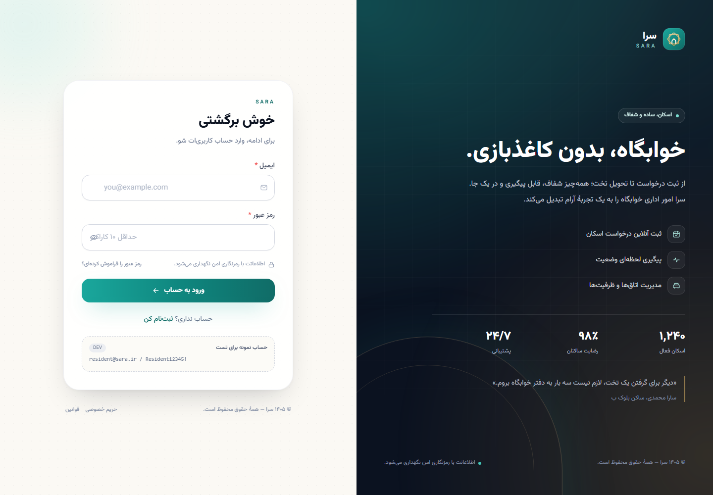
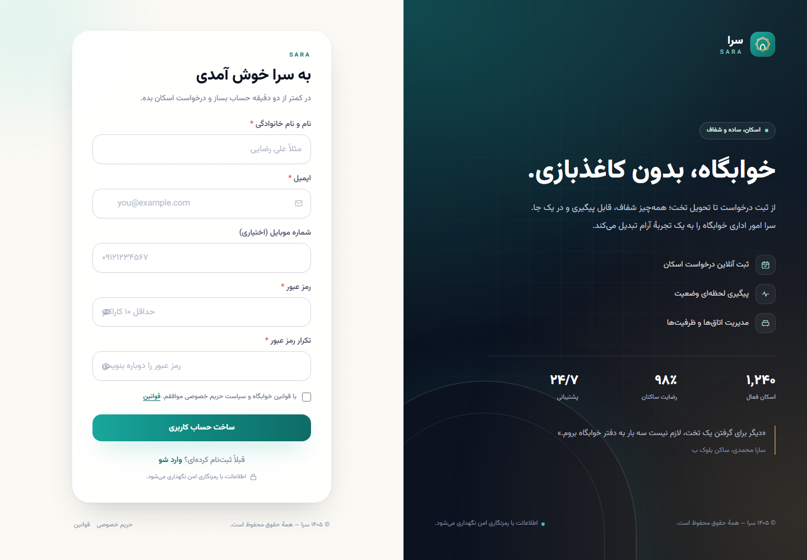
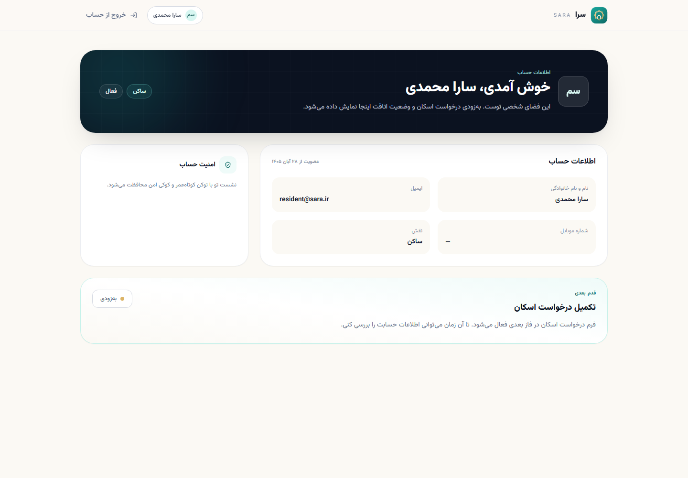
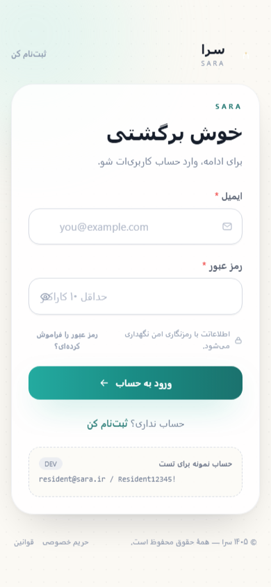

# SARA — سرا

**Self-Governed Dormitory Management System** — a Persian-first, RTL web platform for dormitories run
by a community, cooperative, or private owner.

SARA replaces paper ledgers, handwritten requests, and phone-based approvals with a traceable digital
workflow: a resident signs up, applies for accommodation, and follows the status; a manager reviews
requests and manages rooms and beds inside the dormitories assigned to them; an admin governs accounts
and the system.

> **Status:** the identity slice is implemented end-to-end (registration, login, refresh rotation,
> logout, current profile). The dormitory catalog and request workflow are next. See
> [`Task-List.md`](Task-List.md) for the authoritative status.



---

## Contents

- [What works today](#what-works-today)
- [Screens](#screens)
- [Architecture](#architecture)
- [Quick start](#quick-start)
- [Demo accounts](#demo-accounts)
- [API](#api)
- [Tests and quality gates](#tests-and-quality-gates)
- [Engineering process](#engineering-process)
- [Repository layout](#repository-layout)
- [Security notes](#security-notes)
- [Roadmap](#roadmap)

---

## What works today

| Capability | Status | Evidence |
|------------|--------|----------|
| Public registration with server-side role assignment | Done | `tests/api/test_auth_register.py` |
| Argon2id password hashing; password policy | Done | `tests/unit/test_password_policy.py` |
| Login with uniform failure responses | Done | `tests/api/test_auth_login.py` |
| JWT access token (15 min) + rotating refresh cookie (30 days) | Done | `tests/api/test_auth_refresh.py` |
| Refresh-token reuse detection and family revocation | Done | `test_replay_of_rotated_token_revokes_the_family` |
| Logout, current principal, suspended-account rejection | Done | `tests/api/test_auth_me.py` |
| RFC 9457 Problem Details error model | Done | `tests/api/test_errors.py` |
| Health probes (`/health/live`, `/health/ready`) | Done | `tests/api/test_health.py` |
| Persian/RTL login, registration, dashboard and 404 | Done | `apps/web/tests/unit` + browser journey |
| Alembic baseline and drift check | Done | `alembic check` → *No new upgrade operations detected* |

Not in this slice: email verification, password reset, rate limiting, manager/admin screens,
dormitory catalog, request workflow. These are tracked in [`Task-List.md`](Task-List.md).

---

## Screens

| Login | Registration |
|-------|--------------|
|  |  |

| Authenticated dashboard | Mobile |
|-------------------------|--------|
|  |  |

The UI is Persian-first, fully RTL, keyboard navigable, and responsive from 360 px. All user-facing
strings live in [`apps/web/src/locales`](apps/web/src/locales).

---

## Architecture

SARA is a **modular monolith** with vertical feature slices. The API is one deployable FastAPI
application; the web client is one Vue SPA; the database is the only stateful service.

```
HTTP → Router (api) → Service (application) → Domain (pure)
                            ↓
                     Repository (persistence) → SQLAlchemy → database
```

| Layer | Responsibility | Must not |
|-------|----------------|----------|
| `api` | HTTP, status codes, request/response schemas, auth dependencies | touch the ORM |
| `application` | use cases, transaction boundary, authorization | import FastAPI |
| `domain` | policies, value objects, invariants | perform I/O |
| `persistence` | SQL and ORM mapping | contain business rules |

**Stack**

- **Backend:** Python 3.12, FastAPI, Pydantic v2, SQLAlchemy 2 async, Alembic, PyJWT, pwdlib
  (Argon2id), pytest + httpx.
- **Frontend:** Vue 3 (Composition API, `<script setup>`), TypeScript strict, Vite, Pinia, Vue Router,
  vue-i18n, zod, Tailwind CSS, Vitest + Vue Test Utils.
- **Database:** SQLite (`aiosqlite`) for local development and tests; PostgreSQL is the production
  target. See [`ADR-0012`](docs/adr/ADR-0012-local-and-test-database.md).
- **UI system:** Tailwind plus owned accessible primitives; PrimeVue is deliberately deferred until a
  complex widget justifies it. See [`ADR-0013`](docs/adr/ADR-0013-ui-primitives-and-tailwind.md).

---

## Quick start

**Prerequisites:** Python 3.12+, Node 20+ with pnpm 9+.

```powershell
# 1. backend
python -m venv .venv
.\.venv\Scripts\Activate.ps1
python -m pip install -e "apps/api[dev]"
Copy-Item .env.example apps/api/.env

# 2. schema + demo data (run from the API directory)
cd apps/api
alembic upgrade head
python -m sara_api.db.seed

# 3. API (terminal 1, from apps/api)
uvicorn sara_api.main:app --reload --host 127.0.0.1 --port 8000

# 4. web (terminal 2, from the repository root)
cd ../../apps/web
pnpm install
pnpm dev
```

Open **http://127.0.0.1:5173**. The Vite dev server proxies `/api` to the API on port 8000, so the
refresh cookie is same-origin and `SameSite=Lax` works without CORS credentials gymnastics.

On macOS/Linux replace the activation line with `source .venv/bin/activate` and use `cp`.

### Commands

| Command | What it does |
|---------|--------------|
| `uvicorn sara_api.main:app --reload` | Run the API with auto-reload |
| `pytest` (from `apps/api`) | Backend suite |
| `pnpm dev` (from `apps/web`) | Vite dev server |
| `pnpm test:unit` | Frontend unit tests |
| `pnpm typecheck` | `vue-tsc --noEmit` |
| `pnpm build` | Type-check + production build |
| `alembic -c apps/api/alembic.ini upgrade head` | Apply migrations |
| `alembic -c apps/api/alembic.ini check` | Detect model/migration drift |

PowerShell helpers live in [`scripts/`](scripts/): `seed.ps1`, `dev-api.ps1`, `test.ps1`.

---

## Demo accounts

The seed is idempotent and never runs automatically in production.

| Role | Email | Password |
|------|-------|----------|
| Resident | `resident@sara.ir` | `Resident12345!` |
| Manager | `manager@sara.ir` | `Manager12345!` |
| Admin | `admin@sara.ir` | `Admin12345!` |

The login screen shows the resident credentials in development builds only.

---

## API

Base path `/api/v1`. Interactive documentation: **http://127.0.0.1:8000/api/docs**; OpenAPI:
`/api/openapi.json`.

| Method | Path | Auth | Success | Purpose |
|--------|------|------|:-------:|---------|
| `POST` | `/api/v1/auth/register` | public | `201` | Create a resident account and start a session |
| `POST` | `/api/v1/auth/login` | public | `200` | Authenticate and receive an access token |
| `POST` | `/api/v1/auth/refresh` | refresh cookie | `200` | Rotate the refresh token, issue a new access token |
| `POST` | `/api/v1/auth/logout` | refresh cookie | `204` | Revoke the session family and clear the cookie |
| `GET` | `/api/v1/auth/me` | bearer | `200` | Current principal's public profile |
| `GET` | `/health/live` | public | `200` | Liveness (no database access) |
| `GET` | `/health/ready` | public | `200` / `503` | Readiness (database probe) |

**Session model:** a 15-minute JWT access token returned in the response body (kept in memory by the
SPA) and a 30-day opaque refresh token delivered as an `HttpOnly`, `SameSite=Lax` cookie scoped to
`/api/v1/auth`. Every refresh rotates the token; replaying a rotated token revokes the whole family.
See [`ADR-0005`](docs/adr/ADR-0005-authentication-and-authorization.md).

**Errors** use RFC 9457 Problem Details:

```json
{
  "type": "https://sara.local/errors/email-already-registered",
  "title": "Email already registered",
  "status": 409,
  "code": "email_already_registered",
  "detail": "An account with this email already exists.",
  "instance": "/api/v1/auth/register"
}
```

---

## Tests and quality gates

```powershell
# backend — 48 tests
cd apps/api
pytest

# frontend — 21 tests + strict type check
cd apps/web
pnpm test:unit
pnpm typecheck

# production build
pnpm build
```

The suite covers positive and negative paths: duplicate email, wrong password vs. unknown email
(indistinguishable), expired and tampered tokens, refresh replay, untrusted `Origin`, suspended
accounts, and a missing cookie. API tests run against a real per-test SQLite database, not a mock.

Test-first evidence: the refresh-reuse test initially failed because the family revocation was rolled
back by the 401 transaction; the service now commits the revocation before raising. See
[`PLAN-0003`](docs/plans/PLAN-0003-authentication-and-sessions.md) §9.

> **Not yet wired:** GitHub Actions, `ruff`/`mypy` in CI, coverage thresholds, Playwright. The
> commands and gates are defined in [`AGENTS.md`](AGENTS.md) §14; the local suite is green.

---

## Engineering process

Every feature follows the gates in [`AGENTS.md`](AGENTS.md):

```
Task-List row → SPEC (what) → PLAN (how, test-first) → ADR (if a decision)
             → failing test → implementation → review → Task-List Done
```

| Document | Purpose |
|----------|---------|
| [`AGENTS.md`](AGENTS.md) | The engineering contract: rules, architecture, standards, TDD, DoR/DoD |
| [`Task-List.md`](Task-List.md) | Authoritative backlog and status |
| [`docs/specs/`](docs/specs/) | `SPEC-0001` foundation, `SPEC-0002` registration, `SPEC-0003` sessions |
| [`docs/plans/`](docs/plans/) | Ordered, test-first implementation plans |
| [`docs/adr/`](docs/adr/) | Architecture decisions, including the two made for this slice |

---

## Repository layout

```
apps/api
  src/sara_api/
    main.py            app factory, middleware, routers
    api/deps.py        settings, DB session, current principal
    core/              config, errors, Problem Details, security primitives
    db/                engine, session, base, seed
    domain/            pure account rules and password policy
    modules/auth/      router, service, schemas
    modules/users/     ORM models, repository, public schemas
    modules/health/    liveness and readiness
  migrations/          Alembic baseline
  tests/               unit · integration · api

apps/web
  src/app/             router, i18n
  src/api/             typed fetch client and contract types
  src/modules/auth/    views, components, store, validation
  src/modules/dashboard/
  src/shared/          brand mark, not-found
  src/locales/         fa-IR (default), en-US

docs/                  specs · plans · adr · screenshots
scripts/               seed, dev, test, browser verification
```

---

## Security notes

- Passwords are hashed with Argon2id and never logged or serialized.
- Registration always creates a `user`; a client-supplied `role` is rejected with `422`.
- Login returns one uniform `401 invalid_credentials` for unknown email and wrong password, and hashes
  a dummy password when the account is absent to reduce timing differences.
- Access tokens are short-lived and kept in memory only — never in `localStorage`.
- The refresh token is stored as SHA-256, rotates on every use, and reuse revokes the family.
- `Origin` is checked on cookie-authenticated endpoints.
- The production configuration refuses to boot with the development secret, an insecure cookie flag,
  or auto-created schema.
- **Before public deployment:** add rate limiting (`F-0109`), email verification (`F-0108`), HTTPS +
  `SARA_COOKIE_SECURE=true`, and a Postgres concurrency test (`F-0405`).

---

## Roadmap

| Milestone | Remaining work |
|-----------|----------------|
| **M0 — Foundation** | Docker Compose/Postgres local environment (`F-0004`), CI pipeline |
| **M1 — Identity** | Password reset (`F-0103`), RBAC permissions (`F-0104`), admin user management (`F-0105`), profile/sessions (`F-0106`), audit log (`F-0107`), email verification (`F-0108`), rate limiting (`F-0109`) |
| **M2 — Catalog** | Dormitories, buildings, rooms, beds, public catalog |
| **M3 — Requests & Allocation** | Request submission, review workflow, allocation with concurrency guarantees, residency lifecycle |
| **M4 — Operations** | Reporting, notifications, accessibility/performance hardening, deployment |

---

## License

TBD by the project owner.
