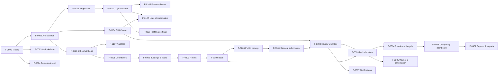

# Task-List.md — SARA Feature Backlog & Delivery Board

> **Project:** SARA (سرا) — Self-Governed Dormitory Management System
> **Document type:** Authoritative feature backlog and status board
> **Version:** 1.0.0 · **Last updated:** 2026-11-19
> **Owner:** Software Architect
> **Companion document:** [`AGENTS.md`](AGENTS.md) (rules, standards, gates)

---

## 1. Purpose and the Control Rule

This file is **the only authoritative status of features**. If a feature is not in this file, it does
not exist. If its status here disagrees with a slide, a chat message, or a commit message, this file
wins and the other source is corrected.

### The hard gate (enforced at review)

> **No implementation starts until the feature's row below has a filled `SPEC` and `PLAN` column,
> both files exist, and both are marked `Approved`.**

The sequence for every new feature is therefore always:

```
1. Add a row to §6 with ID, title, persona, priority, milestone, dependencies → Status: Backlog
2. Write docs/specs/SPEC-XXXX-<slug>.md          → review → Status: Specced   (SPEC Approved)
3. Write docs/plans/PLAN-XXXX-<slug>.md          → review → Status: Planned   (PLAN Approved)
4. Write/accept required ADRs if a decision emerges                        → Status: Ready
5. TDD implementation (Red → Green → Refactor)                              → Status: In Progress
6. PR + review (all CI gates green)                                        → Status: In Review
7. Merge, update this file with PR link, SPEC/PLAN → Implemented            → Status: Done
```

**A row may not skip columns.** A row with `Status: In Progress` and empty `SPEC`/`PLAN` is a process
violation and the PR is closed, not fixed in review.

---

## 2. Status Legend

| Status | Meaning | Who sets it |
|--------|---------|-------------|
| `Backlog` | Identified, not yet specified. Scope may still change. | Architect |
| `Specced` | `SPEC` written and **Approved**. Scope frozen. | Architect |
| `Planned` | `PLAN` written and **Approved**. Tasks, risks, and rollback defined. | Architect / implementer |
| `Ready` | Definition of Ready satisfied (AGENTS.md §15). May be picked up immediately. | Implementer |
| `In Progress` | Red test written; implementation underway. One feature per developer at a time. | Implementer |
| `In Review` | PR open, CI running/green, awaiting reviewer. | Implementer |
| `Blocked` | Cannot proceed; reason and blocker recorded in the Notes column and §8. | Anyone |
| `Done` | Merged to `main`; Definition of Done satisfied; PR link recorded. | Architect |
| `Deferred` | Consciously postponed beyond V1. Needs a new decision to revive. | Architect |
| `Superseded` | Replaced by another feature ID; link kept for history. | Architect |

**Priority (MoSCoW):** `M` = Must (V1 cannot ship), `S` = Should (V1 unless time forces out), `C` =
Could (nice to have), `W` = Won't (recorded to prevent re-litigation).

---

## 3. Milestones

| Milestone | Theme | Exit criteria |
|-----------|-------|---------------|
| **M0 — Foundation** | A running, tested, reproducible skeleton | `make bootstrap && make test` passes on a clean machine; CI green; empty app deployed locally. |
| **M1 — Identity & Access** | Accounts, sessions, roles, admin panel | A user can register, log in, and be assigned a role; every endpoint is permission-tested. |
| **M2 — Dormitory Catalog** | Dorms, buildings, rooms, beds, availability | A manager can model a dormitory; a user can browse it with live availability. |
| **M3 — Requests & Allocation** | The core business value | Resident applies → manager approves → bed allocated → check-in/out, with no double allocation possible. |
| **M4 — Operations & Insight** | Reporting, notifications, hardening, deployment | Manager sees occupancy reports; notifications work; security/a11y review passed; deployable. |

---

## 4. Current Focus

| Field | Value |
|-------|-------|
| **Active milestone** | M1 — Identity & Access |
| **Next feature to start** | `F-0104` — RBAC core (role/permission registry + scope enforcement) |
| **Blocked features** | `F-0004` — Docker/Postgres unavailable on the current workstation |
| **Decisions pending** | none (ADR-0005, 0012, 0013 are `Accepted`) |
| **Working agreements** | TDD mandatory; one feature in `In Progress` at a time; local checks before every push |

> Update this block at the start of every working session. It must never be stale.

---

## 5. Dependency Graph



---

## 6. Feature Backlog

### M0 — Foundation

| ID | Feature | Persona | MoSCoW | Status | SPEC | PLAN | ADR | Depends on |
|----|---------|---------|:------:|--------|------|------|-----|------------|
| **F-0001** | Repository, tooling & CI foundation (monorepo layout, installable packages, pytest + vitest harness, PowerShell helpers, Makefile-equivalent commands) | Architect | M | **Done** | `SPEC-0001` | `PLAN-0001` | 0001, 0004, 0006 | — |
| **F-0002** | Backend skeleton (app factory, settings, structured logging hooks, request-ID middleware, RFC 9457 error model, `/health/live` + `/health/ready`, OpenAPI export) | Architect | M | **Done** | `SPEC-0001` | `PLAN-0001` | 0002 | F-0001 |
| **F-0003** | Frontend skeleton (Vite + Vue 3 + TS strict, router, Pinia, Tailwind design tokens, RTL shell, `fa-IR` locale, Vitest harness) | Architect | M | **Done** | `SPEC-0001` | `PLAN-0001` | 0003, 0013 | F-0001 |
| **F-0004** | Local dev environment & seeding (docker compose: Postgres + Mailpit, `.env.example`, idempotent seeder with demo dormitories and one account per role) | Architect | M | Blocked | `—` | `—` | 0002 | F-0001, F-0002 |
| **F-0005** | Database conventions & migration baseline (naming convention on metadata, UUID PK mixin, timestamps mixin, Alembic baseline, `alembic check`, seed module) | Architect | M | **Done** | `SPEC-0001` | `PLAN-0001` | 0002, 0012 | F-0002 |

### M1 — Identity & Access

| ID | Feature | Persona | MoSCoW | Status | SPEC | PLAN | ADR | Depends on |
|----|---------|---------|:------:|--------|------|------|-----|------------|
| **F-0101** | User registration (public signup, normalized email uniqueness, password policy, Argon2id, immediate session; email verification deferred to F-0108) | User | M | **Done** | `SPEC-0002` | `PLAN-0002` | 0005 | F-0002, F-0005 |
| **F-0102** | Authentication & sessions (login, logout, JWT access token, rotating opaque refresh token with reuse detection, origin guard, current principal) | All | M | **Done** | `SPEC-0003` | `PLAN-0003` | 0005 | F-0101 |
| **F-0103** | Password reset & recovery (request by email, single-use expiring token, revoke all sessions on reset, rate limit + generic response) | All | S | Backlog | `—` | `—` | 0005 | F-0102 |
| **F-0104** | RBAC core (role/permission registry, `require_permission` dependency, dormitory-scope resolution, 401/403/404 semantics, permission matrix tests for every route) | All | M | Backlog | `—` | `—` | 0005 | F-0002 |
| **F-0105** | User administration (admin list/search/filter/paginate, view account, suspend/reactivate/deactivate, role assignment with self-demotion protection, audit emission) | Admin | M | Backlog | `—` | `—` | 0005, 0007 | F-0102, F-0104 |
| **F-0106** | Profile & account settings (view/edit own profile, change password, active sessions list + revoke others, notification preferences) | All | S | Backlog | `—` | `—` | 0005 | F-0102 |
| **F-0107** | Audit log foundation (append-only table, in-transaction writer, actor/entity/action/before-after schema, admin read-only viewer with filters, no PII in payloads) | Admin | S | Backlog | `—` | `—` | 0007 | F-0005 |
| **F-0108** | Email verification (single-use 24 h token, `pending_verification → active`, resend, uniform responses; requires a mail port) | User | S | Backlog | `—` | `—` | 0005 | F-0102 |
| **F-0109** | Auth rate limiting & abuse protection (login/register/reset per IP and per account, 429 + `Retry-After`, blocklist update) | All | M | Backlog | `—` | `—` | 0005 | F-0102 |

### M2 — Dormitory Catalog

| ID | Feature | Persona | MoSCoW | Status | SPEC | PLAN | ADR | Depends on |
|----|---------|---------|:------:|--------|------|------|-----|------------|
| **F-0201** | Dormitory registry (manager-scoped CRUD, address/contact, gender policy, status draft→active→inactive→archived, manager assignment, archive instead of delete) | Manager | M | Backlog | `—` | `—` | 0002 | F-0005, F-0104 |
| **F-0202** | Buildings & floors (CRUD within a dormitory, floor numbering, per-building rules, ordering, cascade rules on archive) | Manager | M | Backlog | `—` | `—` | 0002 | F-0201 |
| **F-0203** | Rooms (room number unique per building, room type, capacity policy, gender policy, amenities, `out_of_service` state, image-free V1) | Manager | M | Backlog | `—` | `—` | 0002 | F-0202 |
| **F-0204** | Beds & availability computation (bed lifecycle, `available/reserved/occupied/blocked/maintenance`, derived capacity, availability query + `EXPLAIN`-verified indexes, partial unique index on active allocation) | Manager | M | Backlog | `—` | `—` | 0002 | F-0203 |
| **F-0205** | Public catalog browsing (user-facing list + detail of active dormitories/rooms, filters by gender/price-range/amenities, live free-bed count, empty/loading/error states, Jalali dates, RTL) | User | M | Backlog | `—` | `—` | 0003 | F-0204 |
| **F-0206** | Media & documents (dorm/room images, house-rules PDF, signed-URL delivery, upload validation) | Manager | C | Backlog | `—` | `—` | 0002 | F-0201 |

### M3 — Requests & Allocation

| ID | Feature | Persona | MoSCoW | Status | SPEC | PLAN | ADR | Depends on |
|----|---------|---------|:------:|--------|------|------|-----|------------|
| **F-0301** | Accommodation request submission — resident slice (form with dormitory preference, room type, desired period, optional note; submit; own-request list; withdraw; one active request per resident. Free-text dormitory until the catalog lands; draft/resume and documents still deferred) | User | M | In Progress | `SPEC-0005` | `PLAN-0005` | 0002 | F-0102 |
| **F-0302** | Request review workflow — manager queue slice (queue with status filter and pagination, applicant names, `submitted → under_review → approved/rejected`, state-machine enforcement, role guard; claim, rejection reason, comments timeline and SLA still deferred) | Manager | M | In Progress | `SPEC-0006` | `PLAN-0006` | 0002, 0005 | F-0301 |
| **F-0303** | Bed allocation (suggested beds by policy, manual assignment, occupancy lock/`FOR UPDATE`, partial unique index, rollback on conflict, allocation event + audit, notification trigger) | Manager | M | Backlog | `—` | `—` | 0008 | F-0302, F-0204 |
| **F-0304** | Residency lifecycle (check-in, extension, room transfer, check-out, early departure, occupancy status sync, resident self-service view) | Manager / User | M | Backlog | `—` | `—` | 0008 | F-0303 |
| **F-0305** | Waitlist & cancellation (ordered waitlist on full capacity, auto-offer on vacancy, cancellation by resident and by manager, withdrawal rules, expiry job) | User / Manager | S | Backlog | `—` | `—` | 0008 | F-0303 |
| **F-0306** | Occupancy dashboard (manager: beds/rooms/occupancy %, pending queue, SLA breaches; personal summary for residents; cached aggregates with explicit invalidation) | Manager / Admin | S | Backlog | `—` | `—` | 0009 | F-0304 |
| **F-0307** | Notifications (in-app inbox + email via pluggable port, templated messages in `fa-IR`, delivery retries via ARQ, read/unread state, preference-aware dedupe) | All | S | Backlog | `—` | `—` | 0010 | F-0302 |

### M4 — Operations & Insight

| ID | Feature | Persona | MoSCoW | Status | SPEC | PLAN | ADR | Depends on |
|----|---------|---------|:------:|--------|------|------|-----|------------|
| **F-0401** | Reports & exports (occupancy over time, request funnel, rejection reasons, per-dormitory utilization; CSV export with streaming; PDF optional) | Manager / Admin | S | Backlog | `—` | `—` | 0009 | F-0306 |
| **F-0402** | System settings & feature flags (admin-editable settings with typed schema, audit on change, safe rollout of new behavior) | Admin | S | Backlog | `—` | `—` | 0007 | F-0105 |
| **F-0403** | Accessibility & performance hardening (axe audits on all primary flows, keyboard-only journey tests, Lighthouse budgets in CI, bundle-size budgets) | All | M | Backlog | `—` | `—` | 0003 | F-0307, F-0401 |
| **F-0404** | Security review & hardening (threat model, ASVS L1 checklist, dependency audit triage, rate-limit tuning, secrets rotation, penetration-test fixes) | All | M | Backlog | `—` | `—` | 0005 | F-0402 |
| **F-0405** | Production deployment & observability (container images, migrations in deploy pipeline, `/metrics`, error tracking, backups + tested restore, runbook, smoke tests) | Architect | M | Backlog | `—` | `—` | 0011 | F-0403, F-0404 |
| **F-0406** | Maintenance & repair tickets — manager side (queue with status filter and pagination, ticket detail with message thread, reply, status `open → under_review → resolved`, role enforcement) | Manager / Admin | S | In Progress | `SPEC-0004` | `PLAN-0004` | 0002, 0005 | F-0102 |
| **F-0407** | Complaints management — manager side (queue with status filter and pagination, complaint detail, `submitted → in_review`, one recorded initial response with `answered` status, role enforcement; resident filing deferred) | Manager / Admin | S | In Progress | `SPEC-0007` | `PLAN-0007` | 0002, 0005 | F-0102 |

### Deferred / Not in V1

| ID | Feature | Why deferred | Revisit when |
|----|---------|--------------|--------------|
| F-0501 | Online payments & invoicing | Out of V1 scope (§1.4) | A financial process is confirmed |
| F-0502 | Maintenance & incident tickets | Promoted to `F-0406` for the manager side; resident submission stays deferred | Resident ticket creation requested |
| F-0503 | Native mobile apps | Responsive web covers V1 | Real usage data demands it |
| F-0504 | SMS notifications | Depends on a provider contract | Provider + budget available |
| F-0505 | Multi-tenant SaaS mode | Premature; single-operator V1 | Multiple operators onboard |
| F-0506 | Anonymous public booking (Cal.com-style) | Contradicts residency model | Product decision reversal |

---

## 7. Feature Intake Template

Copy this block to §6 when adding a feature. Every field is mandatory at `Backlog` time; `SPEC` and
`PLAN` may be `—` until the gates are passed.

```markdown
| **F-0XXX** | <feature name — outcome-oriented, not "user module"> | <Admin/Manager/User/All> | <M/S/C/W> | Backlog | `—` | `—` | <ADR ids> | <F-ids> |
```

**Intake checklist (before the row is accepted):**

- [ ] The feature is a **vertical slice** with observable user value, not a technical layer.
- [ ] It is small enough that SPEC + PLAN fit on two pages each.
- [ ] Its dependencies are listed and are already `Done` or scheduled before it.
- [ ] A rough effort estimate (`S` ≤ 1 day, `M` 2–3 days, `L` 4–5 days) is recorded in the Notes.
- [ ] Any architectural decision it forces is listed in the `ADR` column, even if not yet written.

---

## 8. Blocked & At-Risk Register

| Feature | Blocker | Owner | Since | Next action |
|---------|---------|-------|-------|-------------|
| `F-0004` | Docker/PostgreSQL is not installed on the current workstation, so the compose-based local environment cannot be verified | Architect | 2026-11-19 | Install Docker Desktop or a local PostgreSQL 16; SQLite is the interim strategy (ADR-0012) |
| `F-0108` | No mail transport exists yet; accounts are active immediately | Architect | 2026-11-19 | Add a pluggable mail port (Mailpit locally) as part of the notification feature or F-0108 |
| `F-0109` | Requires a decision on the rate-limit store (in-memory vs Redis) | Architect | 2026-11-19 | Decide with F-0307/F-0405; rate limiting must land before public deployment |

Update this table whenever a feature enters or leaves `Blocked`. An empty table should say "none".

---

## 9. Done Log (reverse chronological)

| Date | Feature | PR | Notes |
|------|---------|----|-------|
| 2026-11-19 | *Project bootstrap (documents only)* | — | `AGENTS.md`, `Task-List.md`, ADR 0001–0006, SPEC/PLAN templates created. No code yet. |
| 2026-11-19 | `F-0001` / `F-0002` / `F-0003` / `F-0005` | local | Monorepo skeleton, FastAPI app factory, RFC 9457 errors, health probes, isolated test harness, Vue shell with RTL/i18n, Tailwind tokens, Alembic baseline. 48 backend tests. |
| 2026-11-19 | `F-0101` / `F-0102` | local | Registration, Argon2id, login, JWT + rotating refresh cookie, reuse detection, logout, `/me`, origin guard; Persian login/register/dashboard screens. 21 frontend tests; browser journeys verified. |

---

## 10. Milestone Progress

| Milestone | Features | Done | Progress |
|-----------|:--------:|:----:|----------|
| M0 — Foundation | 5 | 4 | 80% |
| M1 — Identity & Access | 9 | 2 | 22% |
| M2 — Dormitory Catalog | 6 | 0 | 0% |
| M3 — Requests & Allocation | 7 | 0 | 0% |
| M4 — Operations & Insight | 6 | 0 | 0% |
| **Total** | **33** | **6** | **18%** |

> Update this table in the same PR that changes a feature's status to `Done`. It is a derived view —
> when it disagrees with §6, §6 is correct and this table must be recomputed.

---

## 11. Change Log of This Document

| Date | Change | By |
|------|--------|----|
| 2026-11-19 | v1.0.0 — initial backlog: 30 features across 5 milestones, gates and templates. | Architect |
| 2026-11-19 | v1.1.0 — F-0001/0002/0003/0005 and F-0101/0102 marked Done with evidence; added F-0108 (email verification) and F-0109 (rate limiting); ADR-0005 Accepted, ADR-0012/0013 added. | Architect |
| 2026-11-24 | v1.2.0 — F-0406 (maintenance tickets, manager side) added with SPEC-0004 / PLAN-0004; F-0502 recorded as promoted. | Architect |
| 2026-11-25 | v1.3.0 — F-0301 resident slice specified in SPEC-0005 / PLAN-0005 (free-text dormitory until F-0205; manager review still F-0302). | Architect |
| 2026-11-25 | v1.4.0 — F-0302 manager queue slice specified in SPEC-0006 / PLAN-0006 and moved to In Progress (status changes only; claim, reason, timeline and SLA deferred). | Architect |
| 2026-11-25 | v1.5.0 — F-0101 amended by SPEC-0002 v1.1.0: registration now requires the national ID (unique), mobile number and home address. | Architect |
| 2026-11-26 | v1.6.0 — F-0407 (complaints: review + initial response, manager side) added with SPEC-0007 / PLAN-0007. | Architect |

---

## 12. Immediate Next Step

**Start `F-0104`** (RBAC core) only after writing its documents:

1. `docs/specs/SPEC-0004-rbac-core.md` — permission registry, `require_permission`, scope resolution,
   401/403/404 semantics, route-by-route matrix.
2. `docs/plans/PLAN-0004-rbac-core.md` — ordered TDD tasks (registry → dependency → scope-aware
   repository example → route audit test → admin/manager guard).
3. Only then implement. `F-0104` is the foundation for manager-scoped catalog work (`F-0201`) and
   admin user management (`F-0105`).

The identity slice (`F-0101`, `F-0102`) is complete and covered by 48 backend and 21 frontend tests.
The next infrastructure follow-ups are CI (GitHub Actions) and the Postgres CI job; neither blocks
`F-0104` locally.
